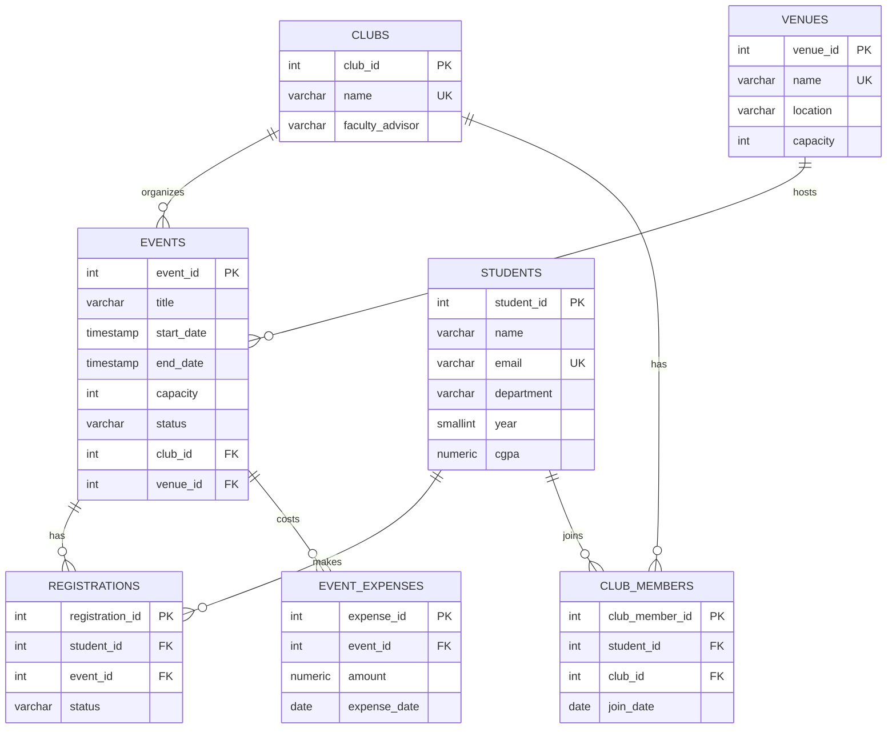

# University Event and Club Management System (CampusEvents)

A small web application for managing **clubs, events, students, venues, registrations, and event expenses** in one place.
The data is stored in **PostgreSQL**. The website is built with **Python Flask** and only runs the SQL queries that are written in plain `.sql` files.

> **Course:** CSE 3210 – Database System Laboratory
> **Group:** B2
> **University:** Khulna University of Engineering and Technology (KUET)

---

## Table of contents

1. [What this project does](#1-what-this-project-does)
2. [Features](#2-features)
3. [Technology used](#3-technology-used)
4. [Project structure](#4-project-structure)
5. [Database design](#5-database-design)
6. [Business rules (how the data stays correct)](#6-business-rules-how-the-data-stays-correct)
7. [Roles and permissions](#7-roles-and-permissions)
8. [How the website works](#8-how-the-website-works)
9. [Setup guide (step by step)](#9-setup-guide-step-by-step)
10. [Using the website](#10-using-the-website)
11. [Sample data](#11-sample-data)
12. [SQL concepts used (lab topics)](#12-sql-concepts-used-lab-topics)
13. [Reset and rebuild](#13-reset-and-rebuild)
14. [Troubleshooting](#14-troubleshooting)
15. [Limitations](#15-limitations)
16. [Team](#16-team)

---

## 1. What this project does

Universities run seminars, workshops, competitions, and cultural programs. When the schedule, registrations, venues, and expenses are kept in different places, the data becomes inconsistent.

This project keeps everything in one **relational database** and gives a simple website on top of it:

- Students can see events and register.
- Club administrators can manage events, participants, and expenses.
- The system administrator can manage everything.
- Reports show registrations, club activity, and money spent.

The main goal is to practise **PostgreSQL**: table design, constraints, CRUD, joins, aggregate functions, subqueries, and roles.

**Design idea:** all SQL lives in `.sql` files. Python only loads the queries and runs them. Every page on the website has a **"SQL used"** box that shows the exact query behind it.

---

## 2. Features

### By module

| Module | What you can do |
|---|---|
| **Students** | Add, edit, delete, and search students (name, email, phone, department, year, CGPA) |
| **Clubs** | Manage clubs and see members and events per club |
| **Club members** | Add or remove students from clubs |
| **Venues** | Manage venues and their seating capacity |
| **Events** | Create, update, search, cancel, and delete events. See seats taken and seats left |
| **Registrations** | Register students for events, cancel, mark as attended |
| **Expenses** | Record money spent on each event |
| **Reports** | 7 ready reports (see below) |

### Other features

- **Search** on every list page (case-insensitive).
- **Status badges** for events and registrations (scheduled, completed, cancelled, registered, attended).
- **Seats left** is calculated from the registrations table. It is not stored, so it can never go out of date.
- **Database roles:** the website connects to PostgreSQL as Admin, Club admin, or Student, and PostgreSQL itself decides what each role may do.
- **Clear error messages** that come from the database (for example "permission denied" or "duplicate key").
- **"SQL used" box** on every page to show the real query.
- **Sample data** that uses dates relative to today, so demos always work.

### Reports

1. Registrations per event (seats taken, seats left, occupancy %)
2. Club activity (members and events per club)
3. Expenses per event
4. Expenses per club
5. Expenses per month
6. Most active students
7. Students per department (with average CGPA)

---

## 3. Technology used

| Layer | Choice |
|---|---|
| Database | PostgreSQL |
| Backend | Python 3 with Flask |
| Database driver | psycopg 3 (`psycopg[binary]`) |
| Settings | python-dotenv (reads the `.env` file) |
| Frontend | HTML templates (Jinja) with CSS, no external libraries |
| Tools | pgAdmin 4, Visual Studio Code |

---

## 4. Project structure

```
event_system/
├── sql/
│   ├── 01_schema.sql         Tables, keys, constraints, indexes
│   ├── 02_sample_data.sql    Sample records
│   ├── 03_roles.sql          Database roles (run only once)
│   ├── 04_grants.sql         Who may do what (GRANT)
│   ├── 05_lab_queries.sql    Demo queries for pgAdmin (run one at a time)
│   └── app_queries.sql       Every query the website runs, by name
├── templates/
│   ├── base.html             Page layout, menu, and styles
│   ├── login.html            Role selection page
│   ├── index.html            Home page with overview cards
│   ├── list.html             One generic table page (used by every module)
│   ├── form.html             One generic add/edit form
│   └── reports.html          The report tables
├── app.py                    The Flask application
├── requirements.txt          Python packages
└── .env                      Your local settings (create it yourself, do not upload it)
```

---

## 5. Database design

### Tables (7)

| Table | Purpose | Main columns |
|---|---|---|
| `students` | Student records | student_id, name, email, phone, department, year, cgpa |
| `clubs` | Clubs | club_id, name, description, email, faculty_advisor |
| `venues` | Places for events | venue_id, name, location, capacity |
| `events` | Events | event_id, title, description, start_date, end_date, capacity, status, club_id, venue_id |
| `club_members` | Which student is in which club | club_member_id, student_id, club_id, join_date |
| `registrations` | Which student registered for which event | registration_id, student_id, event_id, registration_date, status |
| `event_expenses` | Money spent on events | expense_id, event_id, description, amount, expense_date |

### Relationships

- One **club** organizes many **events**.
- One **venue** hosts many **events**.
- **Students** and **clubs** are many-to-many, through `club_members`.
- **Students** and **events** are many-to-many, through `registrations`.
- One **event** has many **expenses**.

### ER diagram



### Constraints

| Table | Rules |
|---|---|
| `students` | `email` UNIQUE; `year` between 1 and 4; `cgpa` between 0 and 4 |
| `clubs` | `name` UNIQUE |
| `venues` | `name` UNIQUE; `capacity > 0` |
| `events` | `capacity > 0`; `status` is `scheduled`, `completed`, or `cancelled`; `end_date > start_date` |
| `club_members` | A student can join the same club only once (UNIQUE pair) |
| `registrations` | A student can register for the same event only once (UNIQUE pair); `status` is `registered`, `cancelled`, or `attended` |
| `event_expenses` | `amount >= 0` |

### What happens when a row is deleted

| Foreign key | Behaviour | Meaning |
|---|---|---|
| `events.club_id` → clubs | `RESTRICT` | A club that still has events cannot be deleted |
| `events.venue_id` → venues | `RESTRICT` | A venue that still has events cannot be deleted |
| `club_members`, `registrations`, `event_expenses` | `CASCADE` | Deleting a student, club, or event also deletes the rows that belong to it |

Indexes are created on the foreign key columns, and on `registrations (event_id, status)`, to make joins and seat counts faster.

---

## 6. Business rules (how the data stays correct)

These rules are written inside the SQL queries in `sql/app_queries.sql`.

| Rule | How it is done |
|---|---|
| **No duplicate registration** | UNIQUE constraint on `(student_id, event_id)` |
| **No registration when the event is full** | `registrations_insert` inserts a row only if the number of taken seats is lower than the event capacity (a subquery inside `INSERT ... SELECT ... WHERE`) |
| **Registration only for upcoming scheduled events** | The same query checks `status = 'scheduled'` and `start_date > now` |
| **Event capacity cannot be above the venue capacity** | `events_insert` and `events_update` compare with the venue capacity |
| **Event capacity cannot be reduced below the seats already taken** | `events_update` counts the taken seats |
| **No two active events at the same venue at the same time** | A `NOT EXISTS` subquery looks for an overlapping, non-cancelled event at the same venue |
| **Back-to-back events are allowed** | The overlap test uses strict `<` and `>` |
| **Cancelled events do not block a venue** | The overlap test ignores cancelled events |
| **Bad values are refused** | CHECK constraints (capacity, year, CGPA, amount, status, dates) |
| **History is kept** | A registration is "cancelled" by changing its status, not by deleting it |

When a rule refuses a change, the page shows a red message such as *"Not saved. The event is full..."*.

> **Seats taken** means registrations with status `registered` or `attended`. Cancelled registrations do not take a seat.

---

## 7. Roles and permissions

The website uses three PostgreSQL **login roles**. Each one belongs to a **group role** that holds the permissions.

| Login role | Group role | Website label |
|---|---|---|
| `admin_user` | `event_admins` | Admin |
| `club_admin_user` | `event_club_admins` | Club admin |
| `student_user` | `event_students` | Student |

| Table | Admin | Club admin | Student |
|---|---|---|---|
| students | everything | read | read |
| clubs | everything | read | read |
| venues | everything | read | read |
| events | everything | read, add, edit, delete | read |
| club_members | everything | read, add, edit, delete | read, add (join a club) |
| registrations | everything | read, add, edit, delete | read, add, edit (register, cancel) |
| event_expenses | everything | read, add, edit, delete | **no access** |

The permissions are created in `sql/04_grants.sql` with `GRANT`.
On the login page you choose a role, and the website connects to PostgreSQL **as that role**. So the database, not the Python code, decides what is allowed.

Try it: choose **Student** and open the **Expenses** page. You will see `permission denied for table event_expenses`.

---

## 8. How the website works

1. `app.py` reads `sql/app_queries.sql` when it starts. Every query starts with a line like `-- name: students_list`, so Python can find it by name.
2. Each module (students, clubs, venues, events, club members, registrations, expenses) uses the same five query names:
   `<module>_list`, `<module>_get`, `<module>_insert`, `<module>_update`, `<module>_delete`.
3. One generic list page and one generic form page serve all modules. The settings for each module (columns and form fields) are in the `ENT` dictionary in `app.py`.
4. When you choose a role, the website opens a database connection as that role.
5. Each action runs its SQL and commits. If the database returns an error, the changes are rolled back and the message is shown in a red box.
6. Search text is sent as a parameter, never glued into the SQL, so it is safe from SQL injection.

> The `%(name)s` parts in `app_queries.sql` are placeholders that Python fills in. To test a query in pgAdmin, replace them with real values.

---

## 9. Setup guide (step by step)

### What you need

- **Python 3.10 or newer**
- **PostgreSQL 12 or newer** (the installer also gives you pgAdmin 4)
- **Visual Studio Code** (optional, but handy)

### Step 1: Get the code

Click **Code → Download ZIP** on GitHub and extract it, or run:

```
git clone <your-repository-link>
```

### Step 2: Create the database

1. Open **pgAdmin 4**. Expand **Servers**, then your server, and enter your postgres password.
2. Right-click **Databases → Create → Database...**
3. Type `event_db` and click **Save**.

### Step 3: Run the SQL files in order

1. Click **event_db**, then **Tools → Query Tool**. Check the tab says `event_db/...`.
2. For each file below, open it with the **folder icon** (or paste its text) and press **F5**. Wait for `Query returned successfully`.

| Order | File | Notes |
|---|---|---|
| 1 | `sql/01_schema.sql` | Creates the tables |
| 2 | `sql/02_sample_data.sql` | Adds sample records |
| 3 | `sql/03_roles.sql` | Creates the roles. **Run only once** |
| 4 | `sql/04_grants.sql` | Gives permissions to the roles |

Do **not** run `05_lab_queries.sql` as a whole file. It is for demos (see below). Do **not** run `app_queries.sql`, because the website uses it.

You can also use the command line instead of pgAdmin:

```
psql -U postgres -d event_db -f sql/01_schema.sql
psql -U postgres -d event_db -f sql/02_sample_data.sql
psql -U postgres -f sql/03_roles.sql
psql -U postgres -d event_db -f sql/04_grants.sql
```

Quick check in the Query Tool:

```sql
SELECT (SELECT COUNT(*) FROM students)       AS students,       -- 10
       (SELECT COUNT(*) FROM events)         AS events,         -- 7
       (SELECT COUNT(*) FROM registrations)  AS registrations,  -- 23
       (SELECT COUNT(*) FROM event_expenses) AS expenses;       -- 9
```

### Step 4: Create the `.env` file

In the main project folder (next to `app.py`), create a file named exactly `.env`:

```
DB_HOST=localhost
DB_PORT=5432
DB_NAME=event_db
ROLE_PASSWORD=event_pass_123
SECRET_KEY=change-this-to-any-random-text
```

`ROLE_PASSWORD` must match the password written in `03_roles.sql`. Your own postgres password is **not** needed here.

### Step 5: Install the Python packages

Open a terminal in the project folder. On Windows, use **Command Prompt** (PowerShell can block the activate script).

```
py -m venv venv
venv\Scripts\activate
pip install -r requirements.txt
```

On Linux or macOS, use `python3 -m venv venv`, then `source venv/bin/activate`.

### Step 6: Run the website

```
flask --app app run --debug
```

Open **http://127.0.0.1:5000** in your browser. Stop the site with **Ctrl + C**.

---

## 10. Using the website

### Pages

| Page | What it shows |
|---|---|
| Choose a role | Pick Admin, Club admin, or Student |
| Home | Overview cards: students, clubs, venues, events, upcoming events, seats taken |
| Students, Clubs, Venues, Events, Club members, Registrations, Expenses | A table with search, **Add new**, **Edit**, and **Delete** |
| Reports | The 7 reports, each with its SQL |

Use **Switch role** (top right) to change role at any time.

### Things to try (demo scenarios)

| What to do | What you will see |
|---|---|
| **Registrations → Add new:** Imran Hossain + Arduino Basics Bootcamp | *Not saved. The event is full...* (the event has 3 seats and all 3 are taken) |
| **Registrations → Add new:** Rafi Ahmed + Startup Pitch Day | *duplicate key value violates unique constraint* (he is already registered) |
| **Events → Edit** Cricket Tournament, set Status to `scheduled` | *Not saved...* (Inter-Department Football already uses the same field at the same time) |
| **Events → Edit** Arduino Basics Bootcamp, set Capacity to `100` | *Not saved...* (the venue only holds 50) |
| **Clubs → Delete** Robotics Club | A foreign key error (the club still has events) |
| **Role: Student → Expenses** | *permission denied for table event_expenses* |
| **Role: Student → Venues → Add new** | *permission denied for table venues* |
| **Role: Student → Registrations → Add new** for Winter Cultural Night | Saved (students may register) |
| **Role: Club admin → Expenses → Add new** | Saved (club admins manage expenses) |
| **Reports** | Open each **SQL used** box to see the JOIN, GROUP BY, and HAVING queries |

### The `05_lab_queries.sql` file

This file has demo queries for pgAdmin: SELECT, DISTINCT, LIKE, ORDER BY, subqueries, GROUP BY / HAVING, joins, UPDATE, DELETE, ALTER TABLE (inside a transaction that is rolled back), constraint errors, and role demos (`SET ROLE`, `REVOKE`, `GRANT`).
**Select one query with the mouse and press F5.** Do not run the whole file at once.

---

## 11. Sample data

`02_sample_data.sql` adds:

- **10 students** (ECE, CSE, EEE, ME, CE)
- **4 clubs:** Robotics Club, Cultural Society, Sports Club, Entrepreneurship Club
- **4 venues:** ECE Seminar Room (80), University Auditorium (500), Central Field (1000), Computer Lab 2 (50)
- **16 club memberships**
- **7 events**
- **23 registrations**
- **9 expenses** (total 37,050.50)

| Event | Club | Status | Capacity | Seats taken |
|---|---|---|---|---|
| Line Follower Workshop | Robotics | completed | 40 | 3 |
| Poetry Evening | Cultural | completed | 50 | 3 |
| Arduino Basics Bootcamp | Robotics | scheduled | 3 | 3 (full) |
| Inter-Department Football | Sports | scheduled | 200 | 4 |
| Cricket Tournament | Sports | cancelled | 200 | 0 |
| Startup Pitch Day | Entrepreneurship | scheduled | 60 | 3 |
| Winter Cultural Night | Cultural | scheduled | 400 | 4 |

The event dates are **relative to the day you run the file** (for example "10 days ago" or "7 days from now"), so the upcoming and completed events always make sense. Cricket Tournament uses the same field and time as the football match on purpose. It is cancelled, so it does not block the venue.

---

## 12. SQL concepts used (lab topics)

| Concept | Where to find it |
|---|---|
| CREATE TABLE, data types, PRIMARY KEY, FOREIGN KEY, UNIQUE, CHECK, NOT NULL, DEFAULT | `01_schema.sql` |
| Indexes | `01_schema.sql` |
| INSERT | `02_sample_data.sql`, `*_insert` queries |
| SELECT with WHERE, DISTINCT, ORDER BY | `05_lab_queries.sql`, `*_list` queries |
| Pattern matching with LIKE / ILIKE | Search boxes (`ILIKE`), `05_lab_queries.sql` |
| UPDATE and DELETE | `*_update` and `*_delete` queries, `05_lab_queries.sql` |
| ALTER TABLE (ADD, ALTER TYPE, RENAME, DROP COLUMN) | `05_lab_queries.sql` (inside BEGIN ... ROLLBACK) |
| Joins (JOIN, LEFT JOIN, comma join) | `events_list`, `registrations_list`, reports, `05_lab_queries.sql` |
| Aggregate functions (COUNT, SUM, AVG, MAX) | Reports, `05_lab_queries.sql` |
| GROUP BY and HAVING | `report_departments`, `05_lab_queries.sql` |
| Subqueries | `events_list` (derived table), `registrations_insert`, `events_update` |
| COALESCE, ROUND, `to_char` | Reports and list queries |
| Roles, GRANT, REVOKE | `03_roles.sql`, `04_grants.sql`, `05_lab_queries.sql` |
| Transactions (BEGIN, COMMIT, ROLLBACK) | `05_lab_queries.sql`; the website commits or rolls back every action |

---

## 13. Reset and rebuild

| I want to... | Do this |
|---|---|
| Put the sample data back | Run `02_sample_data.sql` again. It empties the tables first and restarts the IDs |
| Rebuild all tables from zero | Run `01_schema.sql`, then `02_sample_data.sql`, then **`04_grants.sql` again** |
| Recreate the roles | Run the two `DROP` lines at the bottom of `03_roles.sql` (remove the `--` first), then run `03_roles.sql`, then `04_grants.sql` |

Remember: permissions belong to the tables, so run `04_grants.sql` again after every rebuild of the tables.

---

## 14. Troubleshooting

| Problem | Fix |
|---|---|
| `'py' is not recognized` | Use `python` instead of `py` |
| `'flask' is not recognized` | The virtual environment is off. Run `venv\Scripts\activate` |
| PowerShell says scripts are disabled | Open a **Command Prompt** terminal instead |
| `TemplateNotFound` | The `templates` folder must sit next to `app.py` |
| `KeyError: 'students_list'` | `sql/app_queries.sql` is missing, empty, or in the wrong folder |
| *Cannot connect to the database* | PostgreSQL is not running, `.env` is missing or misnamed (it must not be `env.txt`), or `03_roles.sql` was not run |
| `password authentication failed for user "admin_user"` | `ROLE_PASSWORD` in `.env` does not match the password in `03_roles.sql` |
| `permission denied` even as Admin | Run `04_grants.sql` again on `event_db` |
| `role "admin_user" already exists` | You already ran `03_roles.sql`. Skip it |
| `relation "students" does not exist` | The SQL files were not run on `event_db`. Check the Query Tool tab name |
| Page looks unstyled after an update | Press **Ctrl + F5** in the browser |

---

## 15. Limitations

This project is made for learning, so some things are kept simple on purpose:

- **There is no username and password login.** You pick a role on the first page.
- **The three database roles share one demo password** (`event_pass_123`). Change it before using this anywhere real.
- **Students are not tied to their own records.** Any student role can edit any registration. A real system would use row-level security or real user accounts.
- The **seat limit, venue capacity check, and venue clash check live in the website's SQL queries**, not inside the tables. A direct `INSERT` typed in pgAdmin can still go past these limits. Constraints (UNIQUE, CHECK, FOREIGN KEY) always apply.
- To register again after cancelling, **edit the old registration and set it back to `registered`**. A second insert is refused as a duplicate.
- Roles belong to the whole PostgreSQL server, not to one database.

---

## 16. Team

**Group B2 – CSE 3210, Database System Laboratory, KUET**

| Name | Roll |
|---|---|
| (add name) | (add roll) |
| (add name) | (add roll) |
| (add name) | (add roll) |
| (add name) | (add roll) |
